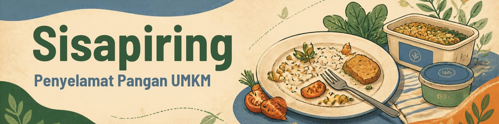
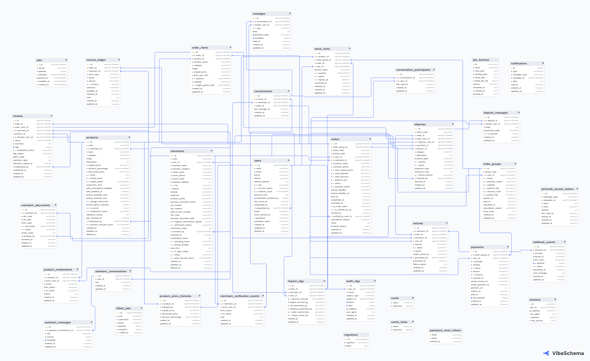

<div align="center">
  

  <h3>🍃 Save Food. Reduce Waste. Create Impact.</h3>

  <p align="center">
    Platform digital B2C (Mobile-First) yang mengubah <b>makanan sisa piring UMKM</b> menjadi <b>peluang ekonomis</b> dan <b>aksi nyata penyelamatan lingkungan</b>.
  </p>

  <!-- Badges untuk estetika dan kesan profesional -->
  
  
  
</div>

---

## 👥 The Squad behind SisaPiring

| Nama | Peran | Fokus Pekerjaan (Job Desk) | GitHub |
| :--- | :--- | :--- | :--- |
| **Tifayatul Husna Azahra** | **Frontend** *(The Builder)* | *Coding* antarmuka. Memastikan desain *mobile-first* (berbentuk memanjang seperti HP) agar realistis digunakan pembeli di lapangan. | [ifaaYourStarz07](https://github.com/ifaaYourStarz07) |
| **Rafaditya Syahputra** | **Backend & DB** *(The Logic)* | Menangani sistem *auth*, CRUD, *countdown timer*, sistem kuncian stok sementara, & rumus di *Impact Dashboard*. | [@Raditt10](https://github.com/Raditt10) |
| **Nabil Akbar Fadhillah** | **UI/UX Design** *(The Artist)* | Membuat *wireframe*. Merekam & mengedit video demo menggunakan CapCut (transisi & efek). | [@nesnt](https://github.com/nesnt) |
| **Kaisa Vidya Amatullah** | **Project Manager** *(The Pitcher)* | *Hustler* utama. Menulis script video, *pitch deck*, menjadi aktor demo, & melakukan *QA Testing* ketat mencari bug. | [@kaisavidya-commits](https://github.com/kaisavidya-commits) |

---

## 🚨 The Problem We're Solving

> [!IMPORTANT]
> **Tahukah Anda?** Setiap harinya, ratusan UMKM (warung, *bakery*, dll) membuang produk layak konsumsi hanya karena mendekati jam tutup. Ini bukan hanya kerugian finansial, tetapi *food waste* adalah salah satu penyumbang gas metana terbesar yang merusak bumi.

**SisaPiring** hadir untuk memutus rantai tersebut. Kami menghubungkan UMKM dengan masyarakat yang mencari makanan berkualitas dengan harga miring, sambil memastikan transparansi keamanan pangan.

---

## 🕹️ How It Works (User & Data Flow)

Kami merancang SisaPiring dengan alur yang sangat singkat agar UMKM dan pembeli tidak repot:

1. 🏪 **UMKM Upload (Checklist Aman):** UMKM mengisi *Food Safety Checklist* dan mengunggah makanan sisa piring dengan skema diskon bertingkat (50%, 70%, hingga 100% donasi). Data masuk ke database.
2. ⏳ **Race Against Time:** Sistem (Backend) menjalankan *countdown timer* berdasarkan batas waktu aman. Pembeli berebut memesan, dan sistem otomatis melakukan *Stock Locking*.
3. 📦 **QR Pick-Up:** Pembeli datang langsung ke lokasi sebelum toko tutup. UMKM memindai QR Code pembeli untuk verifikasi serah terima.
4. 🌍 **Impact Tracked:** Transaksi (Data *Completed*) dikirim ke *Impact Dashboard* untuk dikonversi menjadi data estimasi gas metana yang berhasil dicegah hari ini!

---

## ✨ Features & Innovation

| Ikon | Fitur Utama | Deskripsi |
| :--- | :--- | :--- |
| 🛡️ | **Food Safety Checklist** | UMKM wajib mengonfirmasi kelayakan penyimpanan dan batas aman konsumsi sebelum produk tayang. |
| 💸 | **Rescue Deals** | Sistem diskon dinamis bertingkat. Mulai dari 50% (*Rescue Deal*) hingga 100% (*Food Donation*). |
| ⏱️ | **Flash Sale & Stock Lock** | Pembeli dipacu adrenalin dengan *timer*. Kuncian stok mencegah 2 orang memesan porsi terakhir. |
| 📱 | **QR Pickup Verification** | Tanpa kurir. Pengambilan langsung ke toko yang diverifikasi cepat melalui pemindaian QR Code. |
| 📊 | **Impact Dashboard** | *(Inovasi Utama)* Bukan sekadar riwayat pesanan, tapi konversi makanan terselamatkan ke metrik lingkungan. |

---

## 💻 Tech Stack

-   **Frontend:**    
-   **Backend & DB:**   

---

## 🏗️ System Architecture

Skema database (ERD) SisaPiring:

<div align="center">
  
  <span>
  <a href="https://vibe-schema.com/s/qA9vYwVdfs-GRKo-u-Q69W07gY0">Lihat Detail ERD di VibeSchema</a></span>
</div>

---

## 🚀 Getting Started (Installation & Config)

Jika juri atau pengembang ingin menjalankan SisaPiring di *local environment*, ikuti langkah berikut:

<details>
<summary><b>Klik untuk melihat panduan instalasi lokal</b></summary>

Prasyarat: Node.js, PHP 8.2+, Composer, dan MySQL/MariaDB (misalnya lewat XAMPP).

1. **Clone repository ini**
   ```bash
   git clone https://github.com/sisapiring-team/sisapiring.git
   cd sisapiring
   ```

2. **Install Dependencies**
   ```bash
   npm install
   composer install
   ```

3. **Konfigurasi Environment (.env)**
   Salin file template `.env.example` menjadi `.env`, lalu buat kunci aplikasi:
   ```bash
   cp .env.example .env
   php artisan key:generate
   ```
   Buka file `.env` dan sesuaikan koneksi database (contoh untuk XAMPP). Buat dulu database kosong bernama `sisapiring`:
   ```env
   DB_CONNECTION=mariadb
   DB_HOST=127.0.0.1
   DB_PORT=3306
   DB_DATABASE=sisapiring
   DB_USERNAME=root
   DB_PASSWORD=
   ```
   Jangan sertakan API key asli di repo.

4. **Siapkan Database**
   ```bash
   php artisan migrate --seed
   ```

5. **Jalankan Aplikasi** (dua terminal)
   ```bash
   php artisan serve
   ```
   ```bash
   npm run dev
   ```
   Buka `http://localhost:5173`. **Sangat disarankan menekan F12 (Inspect) dan memilih tampilan Mobile** untuk pengalaman UI/UX yang optimal.

</details>

---

## 🔑 Demo Accounts

Gunakan kredensial berikut untuk mencoba fitur aplikasi tanpa perlu mendaftar:

- **Akun UMKM (Seller):** `seller@sisapiring.com` | Pass: `SisaPiring123`
  *(Bisa untuk tes upload menu sisa piring, checklist keamanan, dan scan QR).*
- **Akun Pembeli (Buyer):** `buyer@sisapiring.com` | Pass: `SisaPiring123`
  *(Bisa untuk tes lihat hitung mundur, pesan makanan, dan cek Impact Dashboard).*

---

## 🤖 AI Usage & Attributions

**Penggunaan AI dalam Pengembangan:**
*   **ChatGPT / Gemini:** Untuk optimasi *copywriting* aplikasi, kerangka *pitch deck*, dan *troubleshooting bug* terkait sinkronisasi *countdown timer* antara frontend dan backend.
*   **GitHub Copilot:** Auto-completion saat *coding* komponen antarmuka Tailwind.

**Atribusi Pihak Ketiga:**
*   **Iconography:** Lucide Icons & Freepik.
*   **Typography:** Google Fonts (Inter).
*   **UI Framework:** shadcn/ui.
*   **Audio/Video:** Library bebas royalti dari CapCut.
*   *Catatan: Seluruh data restoran di dalam aplikasi merupakan data dummy (mock) untuk keperluan pengujian dan demonstrasi.*

<br>
<p align="center">Made by <b>SisaPiring Team</b></p>